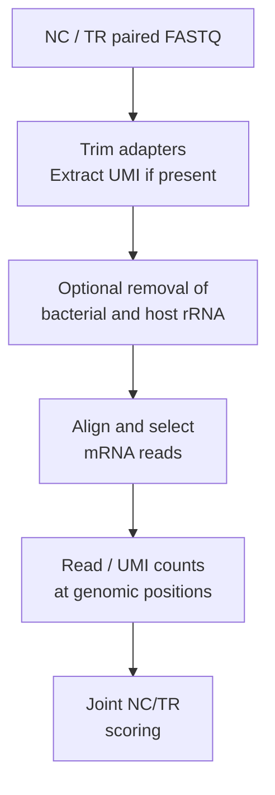

# NJU-seq

**English** | [简体中文](README.zh-CN.md)

**N**m-site **J**udged **U**niversally **seq**uencing compares RNA read-end counts between NC controls and TR treatment samples to identify candidate 2′-*O*-methylation (Nm) sites.

`nju-seq` is the Rust implementation of the NJU-seq analysis workflow, currently version 0.5.0. It processes paired FASTQ through adapter trimming, optional UMI extraction and rRNA removal, mRNA alignment, end counting, and NC/TR scoring.

This guide describes the shared workflow and input requirements. Complete examples are provided for [human HEK293T samples](#6-human-example-hek293t) and [Arabidopsis libraries with 8 nt UMIs](docs/arabidopsis_umi.md). Bundled rRNA sequences are in [data](data); experimental details are in the [sample list](sample_list.csv).

[Installation](#1-installation) · [References](#2-reference-preparation) · [Input data](#3-input-data) · [Analysis](#4-alignment-counting-and-scoring) · [rRNA and downstream analysis](#5-rrna-and-downstream-analysis) · [Human example](#6-human-example-hek293t)

<details>
<summary>Workflow overview</summary>



</details>

## 1. Installation

Run the following commands from the repository root on Linux. Install the tools with Conda using [environment.yml](environment.yml):

```bash
conda env create -f environment.yml
conda activate nju-seq
cargo build --release --offline
target/release/nju-seq --help
```

The environment includes Rust 1.88, Python 3.11, Cutadapt 5.2, Bowtie2 2.5.5, samtools 1.24, gzip, and Perl. The Rust code has no third-party crate dependencies and builds offline once the compiler is installed.

| Tool | Purpose |
|---|---|
| Rust / Cargo ≥1.88 | Build `nju-seq` |
| Cutadapt, gzip | Trim adapters and read/write compressed FASTQ |
| Bowtie2, bowtie2-build | Align reads and build indices; the launch scripts also require Python and Perl |
| Python ≥3.11, samtools | Subset reads and prepare references; samtools builds FASTA indices |
| UMI-tools | Extract 8 nt tags from `umi=r1_3p8` libraries; not needed for `umi=none` |

For a pinned installation and the tools required by UMI, Perl, and R workflows, see [Dependencies](docs/dependencies.md).

## 2. Reference preparation

Choose references for the species being analyzed. Sources for human, mouse, and Arabidopsis are listed below. Exact filenames and download links are in [Reference sources](docs/reference_sources.md).

| Species | Source and release | Genome assembly |
|---|---|---|
| Human | [GENCODE v34](https://www.gencodegenes.org/human/release_34.html) | GRCh38.p13 |
| Mouse | [GENCODE M25](https://www.gencodegenes.org/mouse/release_M25.html) | GRCm38.p6 |
| Arabidopsis | [Ensembl Plants 46](https://ftp.ensemblgenomes.ebi.ac.uk/pub/plants/release-46/) | TAIR10 |

For mRNA analysis, use a transcriptome Bowtie2 index and a matching five-column exon table (`exon.info`). The transcript FASTA, exon annotation, and genome must use the same assembly and release. Host and bacterial rRNA indices are needed only for the selected [rRNA filtering](#rrna-filtering) steps.

Reference construction and Rust mRNA annotation parsing support human GENCODE and Arabidopsis Ensembl formats. Mouse download links are included in the source list; its ENSMUST/ENSMUSG identifiers need an extension to the annotation parser before mRNA analysis.

[Building reference files](references/README.md) provides download, sequence validation, annotation conversion, and index construction commands for human and Arabidopsis. Downloads are cached in `references/downloads`; output and source directories must be new. `--copy-inputs` makes a reference package independently portable; otherwise its relative links to source files must remain valid.

For either species, omit the bacterial build and use `--without-bacterial` instead of `--bac-index` when bacterial filtering is not needed. Select `--rrna-filter host` or `none` during analysis. Species-specific commands are in the [human example](#human-reference-example) and [Arabidopsis UMI workflow](docs/arabidopsis_umi.md#arabidopsis-references).

## 3. Input data

FASTQ files can remain at their existing locations. Create a manifest for your samples and provide it with `--samples`; the input directory and manifest filename can be chosen freely.

The sample manifest is a six-column TSV: `sample role r1 r2 alignment umi`, separated by actual tabs. It requires one NC, at least one TR, and unique sample names. Relative paths are resolved from the manifest's directory. For raw FASTQ input, set `alignment` to `-` and `umi` to `none` or `r1_3p8`, according to the library design.

For raw libraries without UMIs, a manifest saved as `config/samples.tsv` could contain the following rows. Use actual tabs and replace the sample names and paths with your own:

```text
sample	role	r1	r2	alignment	umi
NC1	NC	../inputs/NC1/R1.fq.gz	../inputs/NC1/R2.fq.gz	-	none
TR1	TR	../inputs/TR1/R1.fq.gz	../inputs/TR1/R2.fq.gz	-	none
```

To extract the first 1,000 pairs per sample, use the same manifest. The script checks paired read IDs and preserves each sample’s UMI setting:

```bash
python3 scripts/subset_fastq.py --samples config/samples.tsv \
  --pairs 1000 --skip 0 --out output/my_subset
```

Use the resulting `output/my_subset/samples.tsv` for analysis. For UMI library preparation and a matching manifest, see the [Arabidopsis example](docs/arabidopsis_umi.md).

## 4. Alignment, counting, and scoring

Preview the commands with `plan`, then use the same arguments with `run`. `plan` creates no output; the output directory for `run` must not already exist.

The following template uses all three indices (`--rrna-filter both`). Replace `/path/to/...` with your sample manifest, index prefixes, and matching exon table. Index arguments take a prefix, not an individual `.bt2` file. Choose a new output directory:

```bash
target/release/nju-seq plan \
  --samples /path/to/samples.tsv --from raw \
  --mrna-index /path/to/mrna_index \
  --rrna-index /path/to/host_rrna_index \
  --bac-index /path/to/bacterial_rrna_index \
  --exons /path/to/exon.info --rrna-filter both \
  --out output/my_analysis --threads 2 --jobs 1

target/release/nju-seq run \
  --samples /path/to/samples.tsv --from raw \
  --mrna-index /path/to/mrna_index \
  --rrna-index /path/to/host_rrna_index \
  --bac-index /path/to/bacterial_rrna_index \
  --exons /path/to/exon.info --rrna-filter both \
  --out output/my_analysis --threads 2 --jobs 1
```

`--threads` sets threads per alignment task; `--jobs` sets the number of samples analyzed concurrently. Choose concurrency, disk, and memory limits for the size of your data; see [Helper scripts](docs/scripts.md).

### Inputs and parameters

`--index DIR` supplies the index prefixes `bac`, `rrna`, and `mrna`. Only indices used by the selected filtering steps are required. For other names, specify `--bac-index`, `--rrna-index`, and `--mrna-index` separately.

The default adapters are `AGATCGGAAGAGCACA / GATCGTCGGACTGTAG`; change them with `--adapter-r1` and `--adapter-r2`. Pairs without an adapter match are discarded. The minimum lengths for libraries without UMIs are `10:10`. For `r1_3p8`, the workflow removes the first 8 nt of R2, trims with minimum lengths of `18:10`, and then extracts the last 8 nt of R1 as the UMI. Use `prepared` for reads that have already been trimmed and, where applicable, had their UMIs extracted.

| `--from` | Required input | Remaining steps |
|---|---|---|
| `raw` | Raw paired FASTQ | Adapter trimming, optional UMI extraction, and all subsequent steps |
| `prepared` | Trimmed FASTQ with any UMIs already extracted | Selected rRNA filtering steps, then mRNA analysis |
| `sam` | mRNA SAM and the corresponding FASTQ | SAM filtering and subsequent steps |
| `filtered` | Corresponding FASTQ and a five-column alignment table | Alignment consolidation, R1 sequence checks, and subsequent steps |
| `unique` | Original R1 and a selected five-column alignment table with one row per read; R2 may be `-` | Counting, coordinate merging, and scoring |

rRNA alignment uses `-k 5`; mRNA uses `-a`. Both retain `--reorder --seed 0`. All SAM alignments for a given read must be contiguous.

### rRNA filtering

For `--from raw` or `--from prepared`, `--rrna-filter` selects the rRNA alignment and removal steps before mRNA alignment:

| Value | Bacterial rRNA | Host rRNA | Required index prefixes |
|---|---|---|---|
| `both` (default) | Remove first | Remove next | `bac`, `rrna`, `mrna` |
| `host` | Skip | Remove | `rrna`, `mrna` |
| `bac` | Remove | Skip | `bac`, `mrna` |
| `none` | Skip | Skip | `mrna` |

With `host`, no bacterial index is needed and no bacterial alignment, removal, or QC stage is run. Reads proceed directly to host rRNA filtering. All four choices work with `--storage compact` or `all`, with or without UMIs. Use the same `--rrna-filter` value for `plan` and `run`. Changing the filters can change retained reads and candidate counts. Inputs starting at `sam`, `filtered`, or `unique` already have alignments and do not run these filtering steps.

For chunked mRNA alignment, resuming interrupted batches, and Linux resource limits, see [Helper scripts](docs/scripts.md). `run` does not resume an entire interrupted workflow.

### Outputs

| Main output | Contents |
|---|---|
| `<sample>/mrna.almostuniquematch.filter.tmp` | One selected alignment per accepted read |
| `<sample>/reads/mrna.filter.tsv` | Nine-column genomic read-end counts |
| `mrna.reads.scored.tsv`, `mrna.reads.score_summary.json` | Candidate table and scoring status |
| `qc.html`, per-sample QC TSV files | Offline quality report and metrics |
| `plan.json`, `logs/`, `stages.tsv` | Commands, logs, stage durations, and exit status |
| `SUCCESS` / `FAILED` | Completion or failure marker |

The default `--storage compact` creates a QC report and removes intermediate FASTQ files after success. Use `--storage all` to retain intermediates; QC is off by default in that mode, so add `--qc yes` for a report. Samples with UMIs also produce UMI counts and family tables. Joint UMI scoring requires UMIs in every sample.

## 5. rRNA and downstream analysis

`run` produces mRNA results. To analyze rRNA sites, follow [rRNA counting and scoring](docs/rrna.md) with the host sequences used for alignment. The guide’s commands use human references as an example; replace them with references for your species. FASTA IDs and sequences must match the alignment index. For Arabidopsis, see [rRNA reference export](docs/arabidopsis_umi.md#optional-rrna-analysis).

`nju-seq score --mode mrna|rrna` jointly scores one NC against all TR samples. Interpret the `Candidate`, `EvaluationStatus`, and coordinate fields together; formulas and table formats are described in [Scoring](docs/scoring.md). Candidate thresholds do not provide FDR control or experimental confirmation.

`mrna_analysis/` and `presentation/` contain scripts for motifs, transcript regions, codons, splicing, and plotting. Choose scripts that accept your table format and provide matching annotations. Required R and Perl packages are listed in [Dependencies](docs/dependencies.md).

## 6. Human example: HEK293T

This example uses **GRCh38 / HEK293T samples NJU6096–6099**, with `umi=none` and both bacterial and host rRNA filtering. The paths and expected counts in this section belong to these samples. Install the environment in [section 1](#1-installation), then run the commands from the repository root.

### Human reference example

The following commands prepare references for the human example. The scripts download and verify fixed releases, select sequences, convert GFF3 exons, and create the required indices:

```bash
python3 scripts/build_references.py bacterial \
  --download-dir references/downloads \
  --out references/bacterial --threads 4

python3 scripts/build_references.py human \
  --download-dir references/downloads \
  --source-out references/human_source \
  --bac-index references/bacterial/bac_rna \
  --out references/human_rebuilt --threads 4 --copy-inputs
```

To skip bacterial rRNA removal, omit the bacterial build and replace `--bac-index references/bacterial/bac_rna` with `--without-bacterial` in the human build. Use `--rrna-filter host` when running the analysis; see [rRNA filtering](#rrna-filtering).

The bacterial reference contains 56,117 SILVA 138.2 SSU/LSU sequences from Enterobacteriaceae, Lactobacillaceae, and Streptococcaceae. The human reference contains 84,068 protein-coding transcripts and 762,910 exon rows from GENCODE v34. Host rRNA uses the three sequences in `data/hsa_rrna/{18s,28s,5-8s}.fa`.

By default, this build creates `mrna`, `rrna`, and `bac` index prefixes and `exon.info` in `references/human_rebuilt`. If you choose another output directory, use that path in the analysis commands below.

### Human sample data

In [sample_list.csv](sample_list.csv), NJU6096 is the NC without MgR treatment, and NJU6097–6099 are three TR samples with MgR treatment. All four are HEK293T rRNA-free RNA libraries without UMIs.

The bundled [human example data](tests/data/human/README.md) contain the first **1,000 read pairs** from each sample: eight gzip files totaling about 0.6 MiB. Use them directly in the next section. This consecutive subset illustrates the workflow; it does not represent the distribution of the full libraries or support estimates of their candidate counts.

For the full NJU6096–6099 libraries, place the original FASTQ files or symlinks at `inputs/human/<sample>/R1.fq.gz` and `R2.fq.gz`, then use [config/samples.human.tsv](config/samples.human.tsv). Alternatively, edit the paths in that manifest. To extract a different subset, use the [subsetting command](#3-input-data) with `--samples config/samples.human.tsv`.

### Run the human example

Use the bundled 1,000-pair subset and the references prepared above:

```bash
mkdir -p output
target/release/nju-seq plan \
  --samples tests/data/human/samples.tsv --from raw \
  --index references/human_rebuilt --exons references/human_rebuilt/exon.info \
  --out output/human_example --threads 2 --jobs 1

target/release/nju-seq run \
  --samples tests/data/human/samples.tsv --from raw \
  --index references/human_rebuilt --exons references/human_rebuilt/exon.info \
  --out output/human_example --threads 2 --jobs 1
```

A successful run creates `output/human_example/SUCCESS`. With the matching example references, **18, 13, 5, and 2 reads** pass mRNA selection in the four samples, respectively. Shared coverage in this subset is insufficient for joint normalization: the score summary reports `normalization_unavailable` and zero candidates. This does not establish whether Nm sites are present in the full libraries. See [Example results](docs/results.md) for stage counts and output interpretation.

For the full human dataset, use `--samples config/samples.human.tsv` and a new output directory. Keep the same reference and library settings.

To run these human inputs with host rRNA filtering only, use a separate output directory:

```bash
target/release/nju-seq run \
  --samples tests/data/human/samples.tsv --from raw --rrna-filter host \
  --index references/human_rebuilt --exons references/human_rebuilt/exon.info \
  --out output/human_host_only --threads 2 --jobs 1
```

See [LICENSE](LICENSE) for licensing terms.
