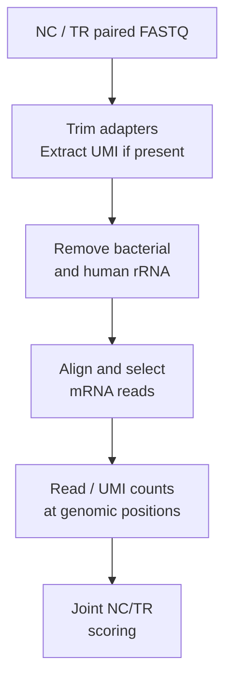

# NJU-seq

**English** | [简体中文](README.zh-CN.md)

**N**m-site **J**udged **U**niversally **seq**uencing compares RNA read-end counts between NC controls and TR treatment samples to identify candidate 2′-*O*-methylation (Nm) sites.

`nju-seq` is the Rust implementation of the NJU-seq analysis workflow, currently version 0.5.0. This guide covers installation, reference preparation, alignment, counting, and scoring using **GRCh38 / HEK293T human samples NJU6096–6099**. Bundled rRNA references are in [data](data); experimental details are in the [sample list](sample_list.csv).

For Col_NC31 / Col_TR31 libraries with 8 nt UMIs, see the [Arabidopsis UMI workflow](docs/arabidopsis_umi.md).

[Installation](#1-installation) · [References](#2-human-references) · [Input data](#3-input-data) · [Analysis](#4-alignment-counting-and-scoring) · [rRNA and downstream analysis](#5-rrna-and-downstream-analysis)

<details>
<summary>Workflow overview</summary>



</details>

## 1. Installation

Run the following commands from the repository root on Linux. Install the tools with Conda using [environment.yml](environment.yml):

```bash
conda env create -f environment.yml
conda activate nju-seq
cargo build --release --offline
target/release/nju-seq --help
```

The environment includes Rust 1.88, Python 3.11, Cutadapt 5.2, Bowtie2 2.5.5, samtools 1.24, gzip, and Perl. The Rust code has no third-party crate dependencies and builds offline once the compiler is installed.

| Tool | Purpose |
|---|---|
| Rust / Cargo ≥1.88 | Build `nju-seq` |
| Cutadapt, gzip | Trim adapters and read/write compressed FASTQ |
| Bowtie2, bowtie2-build | Align reads and build indices; the launch scripts also require Python and Perl |
| Python ≥3.11, samtools | Subset reads and prepare references; samtools builds FASTA indices |
| UMI-tools | Required only for `umi=r1_3p8` libraries; not needed for the human example |

For a pinned installation and the tools required by UMI, Perl, and R workflows, see [Dependencies](docs/dependencies.md).

## 2. Human references

The reference sources for human, mouse, and Arabidopsis are listed below. Exact filenames and download links are in [Reference sources](docs/reference_sources.md).

| Species | Source and release | Genome assembly |
|---|---|---|
| Human | [GENCODE v34](https://www.gencodegenes.org/human/release_34.html) | GRCh38.p13 |
| Mouse | [GENCODE M25](https://www.gencodegenes.org/mouse/release_M25.html) | GRCm38.p6 |
| Arabidopsis | [Ensembl Plants 46](https://ftp.ensemblgenomes.ebi.ac.uk/pub/plants/release-46/) | TAIR10 |

The human example uses the matching reference files below. Prepare the complete references and indices separately, using these paths. File formats are described in [Reference files](references/README.md).

| Path | Contents |
|---|---|
| `references/human_source/hsa_protein_coding.fa` | 84,068 protein-coding transcripts |
| `references/human_source/hsa_exon.info` | Matching five-column exon table |
| `references/human_source/GRCh38.primary_assembly.genome.fa` | GRCh38 genome FASTA |
| `references/bacterial/bac_rna.*.bt2` | All six files of the bacterial rRNA index |
| `data/hsa_rrna/{18s,28s,5-8s}.fa` | Three human rRNA sequences bundled with the repository |

Build a reference directory from the source files:

```bash
python3 scripts/prepare_human_reference.py \
  --mrna references/human_source/hsa_protein_coding.fa \
  --exons references/human_source/hsa_exon.info \
  --genome references/human_source/GRCh38.primary_assembly.genome.fa \
  --bac-index references/bacterial/bac_rna \
  --out references/human_rebuilt --threads 4 \
  --label 'GRCh38 human mRNA and rRNA' \
  --copy-inputs
```

The script checks every transcript against the sequence reconstructed from its genomic exons, then creates the `mrna`, `rrna`, and `bac` indices and `exon.info`. With `--copy-inputs`, the resulting directory can be copied to another machine on its own. Without it, relative symlinks point to the genome and bacterial index, so the source directories must move with it. The output directory must not already exist.

If you already have the prepared `references/human/` directory, replace every `references/human_rebuilt` path below with `references/human`.

## 3. Input data

In [sample_list.csv](sample_list.csv), NJU6096 is the NC without MgR treatment, and NJU6097–6099 are three TR samples with MgR treatment. All four are HEK293T rRNA-free RNA libraries without UMIs.

The bundled [human example data](tests/data/human/README.md) contain the first **1,000 read pairs** from each sample: eight gzip files totaling about 0.6 MiB. Use them directly in the next section. This consecutive subset illustrates the workflow; it does not represent the distribution of the full libraries or support estimates of their candidate counts.

For full datasets, place the original FASTQ files or symlinks at `inputs/human/<sample>/R1.fq.gz` and `R2.fq.gz`, then use [config/samples.human.tsv](config/samples.human.tsv). Alternatively, edit the paths in the manifest. To create a subset:

```bash
python3 scripts/subset_fastq.py --samples config/samples.human.tsv \
  --pairs 1000 --skip 0 --out output/my_subset
```

The sample manifest is a six-column TSV: `sample role r1 r2 alignment umi`, separated by actual tabs. It requires one NC, at least one TR, and unique sample names. Relative paths are resolved from the manifest's directory. For raw FASTQ input, set `alignment` to `-` and `umi` to `none` or `r1_3p8`, according to the library design.

## 4. Alignment, counting, and scoring

Preview the commands with `plan`, then start the analysis with `run`. `plan` creates no output; the output directory for `run` must not already exist.

```bash
mkdir -p output
target/release/nju-seq plan \
  --samples tests/data/human/samples.tsv --from raw \
  --index references/human_rebuilt --exons references/human_rebuilt/exon.info \
  --out output/human_example --threads 2 --jobs 1

target/release/nju-seq run \
  --samples tests/data/human/samples.tsv --from raw \
  --index references/human_rebuilt --exons references/human_rebuilt/exon.info \
  --out output/human_example --threads 2 --jobs 1
```

A successful run creates `output/human_example/SUCCESS`. With the matching example references, **18, 13, 5, and 2 reads** pass mRNA selection in the four samples, respectively. Shared coverage in this subset is insufficient for joint normalization: the score summary reports `normalization_unavailable` and zero candidates. This does not establish whether Nm sites are present in the full libraries. See [Example results](docs/results.md) for stage counts and output interpretation.

For a full analysis, use `--samples config/samples.human.tsv` and a new output directory. `--threads` sets threads per alignment task; `--jobs` sets the number of samples analyzed concurrently. mRNA alignment uses `-a` to report all alignments. Choose concurrency, disk, and memory limits for the size of your data; see [Helper scripts](docs/scripts.md).

| Main output | Contents |
|---|---|
| `<sample>/mrna.almostuniquematch.filter.tmp` | One selected alignment per accepted read |
| `<sample>/reads/mrna.filter.tsv` | Nine-column genomic read-end counts |
| `mrna.reads.scored.tsv`, `mrna.reads.score_summary.json` | Candidate table and scoring status |
| `qc.html`, per-sample QC TSV files | Offline quality report and metrics |
| `plan.json`, `logs/`, `stages.tsv` | Commands, logs, stage durations, and exit status |
| `SUCCESS` / `FAILED` | Completion or failure marker |

The default `--storage compact` creates a QC report and removes intermediate FASTQ files after success. Use `--storage all` to retain intermediates; QC is off by default in that mode, so add `--qc yes` for a report. Samples with UMIs also produce UMI counts and family tables. Joint UMI scoring requires UMIs in every sample.

### Inputs and parameters

`--index DIR` looks for the index prefixes `bac`, `rrna`, and `mrna`. For other names, specify `--bac-index`, `--rrna-index`, and `--mrna-index` separately.

The default adapters are `AGATCGGAAGAGCACA / GATCGTCGGACTGTAG`; change them with `--adapter-r1` and `--adapter-r2`. Pairs without an adapter match are discarded. The minimum lengths for libraries without UMIs are `10:10`. For `r1_3p8`, the workflow removes the first 8 nt of R2, trims with minimum lengths of `18:10`, and then extracts the last 8 nt of R1 as the UMI. Use `prepared` for reads that have already been trimmed and, where applicable, had their UMIs extracted.

| `--from` | Required input | Remaining steps |
|---|---|---|
| `raw` | Raw paired FASTQ | Adapter trimming, optional UMI extraction, and all subsequent steps |
| `prepared` | Trimmed FASTQ with any UMIs already extracted | rRNA removal and subsequent steps |
| `sam` | FASTQ after rRNA removal, plus mRNA SAM | SAM filtering and subsequent steps |
| `filtered` | Corresponding FASTQ and a five-column alignment table | Alignment consolidation, R1 sequence checks, and subsequent steps |
| `unique` | Original R1 and a selected five-column alignment table with one row per read; R2 may be `-` | Counting, coordinate merging, and scoring |

rRNA alignment uses `-k 5`; mRNA uses `-a`. Both retain `--reorder --seed 0`. All SAM alignments for a given read must be contiguous. `--rrna-filter both|bac|host|none` selects which rRNA references to exclude; the default is `both`.

For chunked mRNA alignment, resuming interrupted batches, and Linux resource limits, see [Helper scripts](docs/scripts.md). `run` does not resume an entire interrupted workflow.

## 5. rRNA and downstream analysis

`run` produces mRNA results. To analyze rRNA sites, use the `data/hsa_rrna` references and follow [rRNA counting and scoring](docs/rrna.md).

`nju-seq score --mode mrna|rrna` jointly scores one NC against all TR samples. Interpret the `Candidate`, `EvaluationStatus`, and coordinate fields together; formulas and table formats are described in [Scoring](docs/scoring.md). Candidate thresholds do not provide FDR control or experimental confirmation.

`mrna_analysis/` and `presentation/` contain scripts for motifs, transcript regions, codons, splicing, and plotting. Choose scripts that accept your table format and provide matching annotations. Required R and Perl packages are listed in [Dependencies](docs/dependencies.md).

See [LICENSE](LICENSE) for licensing terms.
