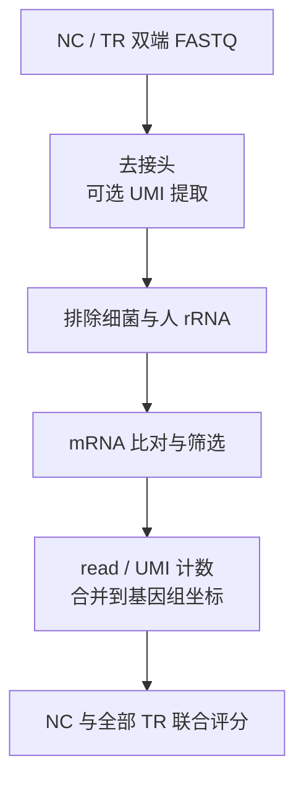

# NJU-seq

[English](README.md) | **简体中文**

**N**m-site **J**udged **U**niversally **seq**uencing：比较 NC 对照与 TR 处理样本的 RNA read 末端计数，筛选 2′-*O*-甲基化（Nm）候选位点。

`nju-seq` 是 Rust 编写的 NJU-seq 分析程序，当前版本 0.5.0。下面以 **GRCh38 / HEK293T 人源 NJU6096–6099** 为例，介绍安装、参考准备、比对、计数和评分。rRNA 参考位于 [data](data)，实验信息见 [样本说明](sample_list.csv)。

含 8 nt UMI 的拟南芥 Col_NC31 / Col_TR31 分析步骤和样本结果见 [拟南芥 UMI 分析流程](docs/arabidopsis_umi.zh-CN.md)。

[安装](#1-安装与构建) · [参考](#2-准备人源参考) · [数据](#3-选择数据) · [分析](#4-比对计数与评分) · [rRNA 与后续分析](#5-rrna-与后续分析)



## 1. 安装与构建

以下命令在仓库根目录运行。使用 Linux 和 Conda，按 [environment.yml](environment.yml) 安装：

```bash
conda env create -f environment.yml
conda activate nju-seq
cargo build --release --offline
target/release/nju-seq --help
```

环境文件包含 Rust 1.88、Python 3.11、Cutadapt 5.2、Bowtie2 2.5.5、samtools 1.24、gzip 和 Perl。Rust 代码不依赖第三方 crate，安装编译器后可离线构建。

| 工具 | 用途 |
|---|---|
| Rust / Cargo ≥1.88 | 编译 `nju-seq` |
| Cutadapt、gzip | 去接头、读写压缩 FASTQ |
| Bowtie2、bowtie2-build | 比对、建立索引；其启动脚本还需要 Python 和 Perl |
| Python ≥3.11、samtools | 抽取小样本、准备参考；samtools 用于建立 FASTA 索引 |
| UMI-tools | 仅 `umi=r1_3p8` 的文库需要，示例人源样本不需要 |

固定版本安装、UMI 文库以及 Perl/R 分析脚本所需的软件见 [依赖说明](docs/dependencies.zh-CN.md)。

## 2. 准备人源参考

人、小鼠、拟南芥的参考来源如下，完整文件名和下载链接见 [三物种参考清单](docs/reference_sources.zh-CN.md)：

| 物种 | 来源与发布版本 | 基因组 |
|---|---|---|
| 人 | [GENCODE v34](https://www.gencodegenes.org/human/release_34.html) | GRCh38.p13 |
| 小鼠 | [GENCODE M25](https://www.gencodegenes.org/mouse/release_M25.html) | GRCm38.p6 |
| 拟南芥 | [Ensembl Plants 46](https://ftp.ensemblgenomes.ebi.ac.uk/pub/plants/release-46/) | TAIR10 |

人源小样本使用下列配套参考，完整文件和索引需另行准备。将文件放在对应目录，具体格式见 [参考说明](references/README.zh-CN.md)。

| 路径 | 内容 |
|---|---|
| `references/human_source/hsa_protein_coding.fa` | 84,068 条 protein_coding 转录本 |
| `references/human_source/hsa_exon.info` | 与转录本匹配的五列 exon 表 |
| `references/human_source/GRCh38.primary_assembly.genome.fa` | GRCh38 基因组 FASTA |
| `references/bacterial/bac_rna.*.bt2` | 细菌 rRNA 索引的六个文件 |
| `data/hsa_rrna/{18s,28s,5-8s}.fa` | 仓库自带的三条人 rRNA 参考 |

从源文件建立参考目录：

```bash
python3 scripts/prepare_human_reference.py \
  --mrna references/human_source/hsa_protein_coding.fa \
  --exons references/human_source/hsa_exon.info \
  --genome references/human_source/GRCh38.primary_assembly.genome.fa \
  --bac-index references/bacterial/bac_rna \
  --out references/human_rebuilt --threads 4 \
  --label 'GRCh38 human mRNA and rRNA' \
  --copy-inputs
```

脚本逐条核对转录本与基因组 exon 重建序列，生成 `mrna`、`rrna`、`bac` 索引及 `exon.info`。`--copy-inputs` 使生成的目录可独立复制到其他机器；省略它会用相对链接引用基因组和细菌索引，需要连同源目录一起移动。输出目录必须尚不存在。

已有的 `references/human/` 也可以直接使用，此时将下面命令中的 `references/human_rebuilt` 统一换为 `references/human`。

## 3. 选择数据

[sample_list.csv](sample_list.csv) 中，NJU6096 是未经过 MgR 处理的 NC，NJU6097–6099 是经过 MgR 处理的三个 TR；均为 HEK293T rRNA-free RNA，无 UMI。

仓库附带 [人源示例数据](tests/data/human/README.zh-CN.md)：每个样本取原始 FASTQ 的前 **1,000 对 reads**，共八个 gzip 文件，约 0.6 MiB，可直接用于下一节命令。该连续子集用于演示分析步骤，不代表整库分布，不能用于估计整库候选数。

使用完整数据时，在 `inputs/human/<sample>/R1.fq.gz`、`R2.fq.gz` 放入原始 FASTQ 或建立链接，使用 [config/samples.human.tsv](config/samples.human.tsv)。也可直接修改清单中的路径。抽取小样本的命令为：

```bash
python3 scripts/subset_fastq.py --samples config/samples.human.tsv \
  --pairs 1000 --skip 0 --out output/my_subset
```

样本清单为六列 TSV：`sample role r1 r2 alignment umi`，列之间使用实际制表符。需要一个 NC、至少一个 TR；样本名唯一，相对路径以清单所在目录为基准。原始 FASTQ 的 `alignment` 填 `-`，`umi` 填 `none` 或 `r1_3p8`。UMI 类型由建库设计决定。

## 4. 比对、计数与评分

先查看将要执行的命令，再运行分析。`plan` 不创建输出；`run` 的输出目录必须尚不存在。

```bash
mkdir -p output
target/release/nju-seq plan \
  --samples tests/data/human/samples.tsv --from raw \
  --index references/human_rebuilt --exons references/human_rebuilt/exon.info \
  --out output/human_example --threads 2 --jobs 1

target/release/nju-seq run \
  --samples tests/data/human/samples.tsv --from raw \
  --index references/human_rebuilt --exons references/human_rebuilt/exon.info \
  --out output/human_example --threads 2 --jobs 1
```

成功运行后会生成 `output/human_example/SUCCESS`。在本示例的配套参考下，四个样本通过 mRNA 筛选的 read 数依次为 **18、13、5、2**。小样本共同覆盖不足，评分摘要为 `normalization_unavailable`，候选为 0；该状态表示无法完成联合归一化，不能据此判断完整数据的 Nm 位点。各步计数和输出解释见 [示例结果](docs/results.zh-CN.md)。

完整分析改用 `--samples config/samples.human.tsv` 并指定新的输出目录。`--threads` 是每个比对任务的线程数，`--jobs` 是同时分析的样本数。mRNA 使用 `-a` 输出全部定位，全量分析需按数据规模设置并行数、磁盘和内存上限，见 [辅助脚本](docs/scripts.zh-CN.md)。

| 主要输出 | 内容 |
|---|---|
| `<sample>/mrna.almostuniquematch.filter.tmp` | 每个通过筛选的 read 一条定位 |
| `<sample>/reads/mrna.filter.tsv` | 九列基因组末端计数 |
| `mrna.reads.scored.tsv`、`mrna.reads.score_summary.json` | 候选表及评分状态 |
| `qc.html`、各样本 QC TSV | 可离线查看的质量报告与指标 |
| `plan.json`、`logs/`、`stages.tsv` | 命令、日志、各步骤耗时及退出状态 |
| `SUCCESS` / `FAILED` | 分析完成或失败的标记 |

默认 `--storage compact` 生成 QC 报告，并在成功后删除中间 FASTQ。使用 `--storage all` 可保留中间文件；该模式默认关闭 QC，需要报告时加 `--qc yes`。声明 UMI 的样本还会生成 UMI 计数与家族表；只有全部样本都有 UMI 时才联合进行 UMI 评分。

### 输入与参数

`--index DIR` 查找 `bac`、`rrna`、`mrna` 三个索引前缀。使用其他名称时分别指定 `--bac-index`、`--rrna-index`、`--mrna-index`。

默认接头为 `AGATCGGAAGAGCACA / GATCGTCGGACTGTAG`，可用 `--adapter-r1`、`--adapter-r2` 修改。未匹配接头的 pairs 会被丢弃；无 UMI 的最短读长为 `10:10`。`r1_3p8` 文库先裁去 R2 起始 8 nt，以 `18:10` 为最短读长裁剪，再提取 R1 末端 8 nt 的 UMI。已去接头并完成可选 UMI 提取的数据应选 `prepared`。

| `--from` | 所需输入 | 接着执行 |
|---|---|---|
| `raw` | 原始双端 FASTQ | 去接头、可选 UMI 提取及后续步骤 |
| `prepared` | 已去接头并完成可选 UMI 提取的 FASTQ | 排除 rRNA 及后续步骤 |
| `sam` | 去 rRNA 后的 FASTQ、mRNA SAM | SAM 筛选及后续步骤 |
| `filtered` | 对应 FASTQ、五列比对表 | 合并定位、核对 R1 序列及后续步骤 |
| `unique` | 原 R1、已筛选且每个 read 一行的五列比对表；R2 可填 `-` | 计数、合并和评分 |

rRNA 使用 `-k 5`，mRNA 使用 `-a`，均保留 `--reorder --seed 0`。处理 SAM 时，同一 read 的全部比对必须连续。`--rrna-filter both|bac|host|none` 选择排除对象，默认 `both`。

分批 mRNA 比对、断点继续和 Linux 资源限制的用法见 [辅助脚本](docs/scripts.zh-CN.md)。`run` 本身不支持整条流程断点恢复。

## 5. rRNA 与后续分析

`run` 输出 mRNA 结果。需要 rRNA 位点结果时，使用 `data/hsa_rrna` 参考，按 [rRNA 计数与评分](docs/rrna.zh-CN.md) 单独运行。

`nju-seq score --mode mrna|rrna` 将一个 NC 与全部 TR 联合评分。输出中的 `Candidate`、`EvaluationStatus` 和坐标类型用于解释结果；公式和表格格式见 [评分说明](docs/scoring.zh-CN.md)。筛选阈值不等同于 FDR 或实验确认。

`mrna_analysis/` 和 `presentation/` 提供 motif、区域、codon、剪接分析及绘图脚本。使用时选择与输入表格式匹配的脚本，并提供配套注释；所需 R/Perl 包见 [依赖说明](docs/dependencies.zh-CN.md)。

许可见 [LICENSE](LICENSE)。
