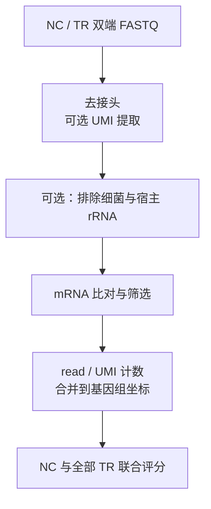

# NJU-seq

[English](README.md) | **简体中文**

**N**m-site **J**udged **U**niversally **seq**uencing：比较 NC 对照与 TR 处理样本的 RNA read 末端计数，筛选 2′-*O*-甲基化（Nm）候选位点。

`nju-seq` 是 Rust 编写的 NJU-seq 分析程序，当前版本 0.5.0。程序从双端 FASTQ 开始，完成去接头、可选 UMI 提取与 rRNA 筛除、mRNA 比对、末端计数和 NC/TR 评分。

本文先介绍通用流程和输入要求，再提供可直接运行的[人源 HEK293T 示例](#6-人源示例hek293t)；含 8 nt UMI 的文库见[拟南芥分析流程](docs/arabidopsis_umi.zh-CN.md)。仓库自带的 rRNA 序列位于 [data](data)，实验信息见[样本说明](sample_list.csv)。

[安装](#1-安装与构建) · [参考](#2-参考准备) · [数据](#3-选择数据) · [分析](#4-比对计数与评分) · [rRNA 与后续分析](#5-rrna-与后续分析) · [人源示例](#6-人源示例hek293t)

<details>
<summary>流程概览</summary>



</details>

## 1. 安装与构建

以下命令在仓库根目录运行。使用 Linux 和 Conda，按 [environment.yml](environment.yml) 安装：

```bash
conda env create -f environment.yml
conda activate nju-seq
cargo build --release --offline
target/release/nju-seq --help
```

环境文件包含 Rust 1.88、Python 3.11、Cutadapt 5.2、Bowtie2 2.5.5、samtools 1.24、gzip 和 Perl。Rust 代码不依赖第三方 crate，安装编译器后可离线构建。

| 工具 | 用途 |
|---|---|
| Rust / Cargo ≥1.88 | 编译 `nju-seq` |
| Cutadapt、gzip | 去接头、读写压缩 FASTQ |
| Bowtie2、bowtie2-build | 比对、建立索引；其启动脚本还需要 Python 和 Perl |
| Python ≥3.11、samtools | 抽取小样本、准备参考；samtools 用于建立 FASTA 索引 |
| UMI-tools | 为 `umi=r1_3p8` 文库提取 8 nt 标签；`umi=none` 时不需要 |

固定版本安装、UMI 文库以及 Perl/R 分析脚本所需的软件见 [依赖说明](docs/dependencies.zh-CN.md)。

## 2. 参考准备

按样本物种选择参考。人、小鼠、拟南芥的参考来源如下，完整文件名和下载链接见 [三物种参考清单](docs/reference_sources.zh-CN.md)：

| 物种 | 来源与发布版本 | 基因组 |
|---|---|---|
| 人 | [GENCODE v34](https://www.gencodegenes.org/human/release_34.html) | GRCh38.p13 |
| 小鼠 | [GENCODE M25](https://www.gencodegenes.org/mouse/release_M25.html) | GRCm38.p6 |
| 拟南芥 | [Ensembl Plants 46](https://ftp.ensemblgenomes.ebi.ac.uk/pub/plants/release-46/) | TAIR10 |

mRNA 分析需要转录组 Bowtie2 索引和配套的五列外显子表（`exon.info`）。转录本 FASTA、外显子注释和基因组须来自相同组装及发布版本。宿主和细菌 rRNA 索引仅在启用对应的 [rRNA 筛除步骤](#rrna-筛除设置)时需要。

参考构建和 Rust mRNA 注释解析支持人 GENCODE 和拟南芥 Ensembl 格式。来源清单同时提供小鼠下载链接；小鼠 mRNA 分析需要在注释解析器中增加对 ENSMUST/ENSMUSG 标识的支持。

[参考文件生成](references/README.zh-CN.md)提供人和拟南芥的下载、序列校验、注释转换及索引构建命令。下载文件缓存在 `references/downloads`，输出目录和源文件目录须为新目录。`--copy-inputs` 使参考目录可独立搬迁；不加此选项时，须保持指向源文件的相对链接有效。

这两个物种均可在不筛除细菌时跳过细菌参考构建，用 `--without-bacterial` 替换 `--bac-index`，分析时选择 `--rrna-filter host` 或 `none`。各物种的具体命令见[人源参考示例](#人源参考示例)和[拟南芥 UMI 流程](docs/arabidopsis_umi.zh-CN.md#使用配套的拟南芥参考)。

## 3. 选择数据

FASTQ 可保留在现有位置。为待分析样本建立清单，通过 `--samples` 指定；输入目录和清单文件名可自行选择。

样本清单为六列 TSV：`sample role r1 r2 alignment umi`，列之间使用实际制表符。需要一个 NC、至少一个 TR；样本名唯一，相对路径以清单所在目录为基准。原始 FASTQ 的 `alignment` 填 `-`，`umi` 填 `none` 或 `r1_3p8`。UMI 类型由建库设计决定。

无 UMI 的原始文库可按以下格式保存为 `config/samples.tsv`。各列使用实际制表符，并将样本名和路径换成自己的输入：

```text
sample	role	r1	r2	alignment	umi
NC1	NC	../inputs/NC1/R1.fq.gz	../inputs/NC1/R2.fq.gz	-	none
TR1	TR	../inputs/TR1/R1.fq.gz	../inputs/TR1/R2.fq.gz	-	none
```

使用同一清单，可为每个样本提取前 1,000 对 reads。脚本检查双端 ID，并保留各样本的 UMI 设置：

```bash
python3 scripts/subset_fastq.py --samples config/samples.tsv \
  --pairs 1000 --skip 0 --out output/my_subset
```

随后使用生成的 `output/my_subset/samples.tsv` 进行分析。含 UMI 文库的准备方式和配套清单见[拟南芥示例](docs/arabidopsis_umi.zh-CN.md)。

## 4. 比对、计数与评分

先用 `plan` 查看命令，再使用相同参数执行 `run`。`plan` 不创建输出；`run` 的输出目录必须尚不存在。

以下模板使用三类索引（`--rrna-filter both`）。将 `/path/to/...` 替换为样本清单、索引前缀和配套外显子表，并选择新的输出目录。索引参数填写前缀，不是某个 `.bt2` 文件：

```bash
target/release/nju-seq plan \
  --samples /path/to/samples.tsv --from raw \
  --mrna-index /path/to/mrna_index \
  --rrna-index /path/to/host_rrna_index \
  --bac-index /path/to/bacterial_rrna_index \
  --exons /path/to/exon.info --rrna-filter both \
  --out output/my_analysis --threads 2 --jobs 1

target/release/nju-seq run \
  --samples /path/to/samples.tsv --from raw \
  --mrna-index /path/to/mrna_index \
  --rrna-index /path/to/host_rrna_index \
  --bac-index /path/to/bacterial_rrna_index \
  --exons /path/to/exon.info --rrna-filter both \
  --out output/my_analysis --threads 2 --jobs 1
```

`--threads` 是每个比对任务的线程数，`--jobs` 是同时分析的样本数。按数据规模设置并行数、磁盘和内存上限，见[辅助脚本](docs/scripts.zh-CN.md)。

### 输入与参数

`--index DIR` 提供 `bac`、`rrna`、`mrna` 三个索引前缀，只要求所选筛除步骤实际使用的索引存在。使用其他名称时分别指定 `--bac-index`、`--rrna-index`、`--mrna-index`。

默认接头为 `AGATCGGAAGAGCACA / GATCGTCGGACTGTAG`，可用 `--adapter-r1`、`--adapter-r2` 修改。未匹配接头的 pairs 会被丢弃；无 UMI 的最短读长为 `10:10`。`r1_3p8` 文库先裁去 R2 起始 8 nt，以 `18:10` 为最短读长裁剪，再提取 R1 末端 8 nt 的 UMI。已去接头并完成可选 UMI 提取的数据应选 `prepared`。

| `--from` | 所需输入 | 接着执行 |
|---|---|---|
| `raw` | 原始双端 FASTQ | 去接头、可选 UMI 提取及后续步骤 |
| `prepared` | 已去接头并完成可选 UMI 提取的 FASTQ | 所选 rRNA 筛除步骤，再进行 mRNA 分析 |
| `sam` | mRNA SAM 及对应 FASTQ | SAM 筛选及后续步骤 |
| `filtered` | 对应 FASTQ、五列比对表 | 合并定位、核对 R1 序列及后续步骤 |
| `unique` | 原 R1、已筛选且每个 read 一行的五列比对表；R2 可填 `-` | 计数、合并和评分 |

rRNA 使用 `-k 5`，mRNA 使用 `-a`，均保留 `--reorder --seed 0`。处理 SAM 时，同一 read 的全部比对必须连续。

### rRNA 筛除设置

对于 `--from raw` 或 `--from prepared`，`--rrna-filter` 决定 mRNA 比对前执行哪些 rRNA 比对和筛除步骤：

| 取值 | 细菌 rRNA | 宿主 rRNA | 所需索引前缀 |
|---|---|---|---|
| `both`（默认） | 先筛除 | 再筛除 | `bac`、`rrna`、`mrna` |
| `host` | 跳过 | 筛除 | `rrna`、`mrna` |
| `bac` | 筛除 | 跳过 | `bac`、`mrna` |
| `none` | 跳过 | 跳过 | `mrna` |

选择 `host` 后不需要细菌索引，也不执行细菌比对、筛除或对应质控，reads 直接进入宿主 rRNA 筛除。四种设置均支持 `--storage compact` 和 `all`，适用于有、无 UMI 的文库。`plan` 和 `run` 应使用相同的 `--rrna-filter` 值。更改筛除设置可能改变保留的 reads 和候选位点数量。从 `sam`、`filtered` 或 `unique` 开始时已有比对结果，不再执行这些筛除步骤。

分批 mRNA 比对、断点继续和 Linux 资源限制的用法见 [辅助脚本](docs/scripts.zh-CN.md)。`run` 本身不支持整条流程断点恢复。

### 输出

| 主要输出 | 内容 |
|---|---|
| `<sample>/mrna.almostuniquematch.filter.tmp` | 每个通过筛选的 read 一条定位 |
| `<sample>/reads/mrna.filter.tsv` | 九列基因组末端计数 |
| `mrna.reads.scored.tsv`、`mrna.reads.score_summary.json` | 候选表及评分状态 |
| `qc.html`、各样本 QC TSV | 可离线查看的质量报告与指标 |
| `plan.json`、`logs/`、`stages.tsv` | 命令、日志、各步骤耗时及退出状态 |
| `SUCCESS` / `FAILED` | 分析完成或失败的标记 |

默认 `--storage compact` 生成 QC 报告，并在成功后删除中间 FASTQ。使用 `--storage all` 可保留中间文件；该模式默认关闭 QC，需要报告时加 `--qc yes`。声明 UMI 的样本还会生成 UMI 计数与家族表；只有全部样本都有 UMI 时才联合进行 UMI 评分。

## 5. rRNA 与后续分析

`run` 输出 mRNA 结果。需要 rRNA 位点结果时，按 [rRNA 计数与评分](docs/rrna.zh-CN.md)操作，并使用实际比对所用的宿主参考序列。该说明中的命令以人源参考为例，分析其他物种时需替换为相应参考。FASTA ID 和序列须与比对索引一致；拟南芥见 [rRNA 参考导出方法](docs/arabidopsis_umi.zh-CN.md#可选-rrna-分析)。

`nju-seq score --mode mrna|rrna` 将一个 NC 与全部 TR 联合评分。输出中的 `Candidate`、`EvaluationStatus` 和坐标类型用于解释结果；公式和表格格式见 [评分说明](docs/scoring.zh-CN.md)。筛选阈值不等同于 FDR 或实验确认。

`mrna_analysis/` 和 `presentation/` 提供 motif、区域、codon、剪接分析及绘图脚本。使用时选择与输入表格式匹配的脚本，并提供配套注释；所需 R/Perl 包见 [依赖说明](docs/dependencies.zh-CN.md)。

## 6. 人源示例：HEK293T

本节使用 **GRCh38 / HEK293T 人源 NJU6096–6099**，设置 `umi=none`，同时筛除细菌和宿主 rRNA。这里的路径和预期计数对应这批样本。按[第 1 节](#1-安装与构建)安装环境后，在仓库根目录运行以下命令。

### 人源参考示例

以下命令为人源示例准备参考。脚本会下载并校验固定版本、筛选序列、转换 GFF3 外显子注释，并建立所需索引：

```bash
python3 scripts/build_references.py bacterial \
  --download-dir references/downloads \
  --out references/bacterial --threads 4

python3 scripts/build_references.py human \
  --download-dir references/downloads \
  --source-out references/human_source \
  --bac-index references/bacterial/bac_rna \
  --out references/human_rebuilt --threads 4 --copy-inputs
```

若不筛除细菌 rRNA，跳过细菌参考构建，将人源构建命令中的 `--bac-index references/bacterial/bac_rna` 换成 `--without-bacterial`，分析时使用 `--rrna-filter host`，见 [rRNA 筛除设置](#rrna-筛除设置)。

细菌参考包含 SILVA 138.2 中 Enterobacteriaceae、Lactobacillaceae 和 Streptococcaceae 三个科的 56,117 条 SSU/LSU 序列。人源参考包含 GENCODE v34 的 84,068 条蛋白编码转录本和 762,910 行 exon；宿主 rRNA 使用 `data/hsa_rrna/{18s,28s,5-8s}.fa` 三条序列。

默认构建会在 `references/human_rebuilt` 生成 `mrna`、`rrna`、`bac` 三个索引前缀及 `exon.info`。若选择其他输出目录，下方分析命令也需使用对应路径。

### 人源样本数据

[sample_list.csv](sample_list.csv) 中，NJU6096 是未经过 MgR 处理的 NC，NJU6097–6099 是经过 MgR 处理的三个 TR；均为 HEK293T rRNA-free RNA，无 UMI。

仓库附带 [人源示例数据](tests/data/human/README.zh-CN.md)：每个样本取原始 FASTQ 的前 **1,000 对 reads**，共八个 gzip 文件，约 0.6 MiB，可直接用于下一节命令。该连续子集用于演示分析步骤，不代表整库分布，不能用于估计整库候选数。

使用 NJU6096–6099 的完整文库时，在 `inputs/human/<sample>/R1.fq.gz`、`R2.fq.gz` 放入原始 FASTQ 或建立链接，使用 [config/samples.human.tsv](config/samples.human.tsv)。也可直接修改该清单中的路径。需要其他子集时，按[抽样命令](#3-选择数据)操作，将参数改为 `--samples config/samples.human.tsv`。

### 运行人源示例

使用仓库自带的每样本 1,000 对 reads，以及上方准备的参考：

```bash
mkdir -p output
target/release/nju-seq plan \
  --samples tests/data/human/samples.tsv --from raw \
  --index references/human_rebuilt --exons references/human_rebuilt/exon.info \
  --out output/human_example --threads 2 --jobs 1

target/release/nju-seq run \
  --samples tests/data/human/samples.tsv --from raw \
  --index references/human_rebuilt --exons references/human_rebuilt/exon.info \
  --out output/human_example --threads 2 --jobs 1
```

成功运行后会生成 `output/human_example/SUCCESS`。在本示例的配套参考下，四个样本通过 mRNA 筛选的 read 数依次为 **18、13、5、2**。小样本共同覆盖不足，评分摘要为 `normalization_unavailable`，候选为 0；该状态表示无法完成联合归一化，不能据此判断完整数据的 Nm 位点。各步计数和输出解释见 [示例结果](docs/results.zh-CN.md)。

分析完整人源数据时，使用 `--samples config/samples.human.tsv` 和新的输出目录，保持相同的参考和文库设置。

若仅对这批人源输入筛除宿主 rRNA，使用另一个输出目录：

```bash
target/release/nju-seq run \
  --samples tests/data/human/samples.tsv --from raw --rrna-filter host \
  --index references/human_rebuilt --exons references/human_rebuilt/exon.info \
  --out output/human_host_only --threads 2 --jobs 1
```

许可见 [LICENSE](LICENSE)。
